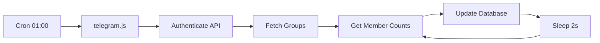
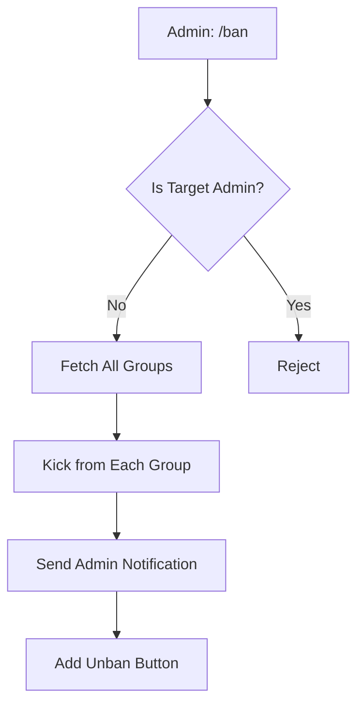
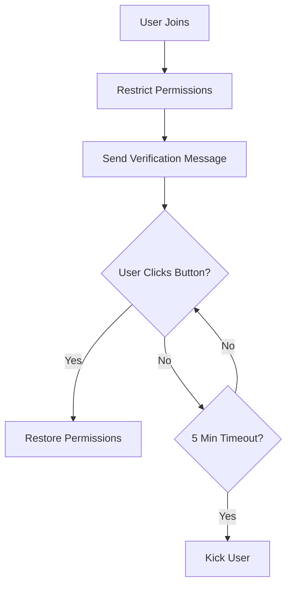

# EksiCode Telegram Bot - Technical Analysis

## 📋 Overview

The **EksiCode Telegram Bot** is a comprehensive community management bot built for the eksicode.org Telegram groups. It provides automated moderation, user verification, content management, and analytics features across multiple Telegram groups.

---

## 🏗️ Architecture

### Multi-Process Architecture

The bot runs **3 separate processes** managed by PM2:

1. **`eksicodeBot-user`** (`telegram.js`) - Cron job for daily member count updates
2. **`eksicodeBot-func`** (`telegram_func.js`) - Main user interaction bot with command handling
3. **`sourcess_controller`** (`sourcess_controller.js`) - Daily source link validation service

### Technology Stack

| Component | Technology | Version |
|-----------|-----------|---------|
| **Framework** | Telegraf | v4.16.3 |
| **Runtime** | Node.js | 20 |
| **Process Manager** | PM2 | Latest |
| **Containerization** | Docker | - |
| **HTTP Client** | Axios | v1.12.2 |
| **Scheduler** | node-cron | v4.2.1 |
| **HTML Parser** | node-html-parser | v7.0.1 |
| **Environment** | dotenv | v17.2.3 |

---

## 📁 Project Structure

```
telegrambot/
├── src/
│   ├── commands/          # 17 command handlers
│   │   ├── ban.js
│   │   ├── unban.js
│   │   ├── verify.js
│   │   ├── kaynak.js
│   │   ├── pin.js
│   │   ├── help.js
│   │   └── ... (11 more)
│   ├── handlers/          # Event handlers
│   │   ├── textHandler.js
│   │   ├── callbackHandler.js
│   │   ├── joinedLeftUserHandler.js
│   │   └── easterEggHandler.js
│   ├── utils/             # Utility modules
│   │   ├── verificationManager.js
│   │   ├── rateLimiter.js
│   │   ├── commandLogger.js
│   │   ├── apiAuth.js
│   │   └── ... (6 more)
│   └── index.js
├── telegram.js            # Cron job process
├── telegram_func.js       # Main bot process
├── sourcess_controller.js # Link validation process
├── pm2.json              # PM2 configuration
├── Dockerfile
└── package.json
```

---

## 🔧 Core Features

### 1. **User Verification System** 🔐

**File**: [`verificationManager.js`](file:///Users/mkltkn/Projects/eksicode/eksicode-latest/telegrambot/src/utils/verificationManager.js)

A sophisticated anti-spam system that requires new members to verify they're human:

- **Auto-restriction**: New members are restricted from sending messages
- **Interactive verification**: Users click a button to verify
- **5-minute timeout**: Auto-kick if not verified within 5 minutes
- **Cleanup timer**: Runs every 60 seconds to remove expired verifications
- **Admin controls**: Force verify, view stats, check pending verifications

**Key Methods**:
- `startVerification(ctx, user)` - Initiates verification for new users
- `handleVerification(ctx, userId)` - Processes verification button clicks
- `handleVerificationTimeout(userId)` - Auto-kicks unverified users
- `forceVerify(telegram, chatId, userId)` - Admin override

### 2. **Rate Limiting** ⏱️

**File**: [`rateLimiter.js`](file:///Users/mkltkn/Projects/eksicode/eksicode-latest/telegrambot/src/utils/rateLimiter.js)

Prevents command spam and abuse:

- **Per-user, per-command limits**: Default 5 requests per minute
- **Sliding window**: Automatically clears old requests
- **Configurable**: Custom limits and windows per command
- **Memory-based**: Uses Map for fast lookups

**Example Usage**:
```javascript
if (rateLimiter.isLimited(ctx.from.id, 'verify', 5, 60000)) {
  return ctx.reply('⏰ Çok hızlı! Lütfen biraz bekleyin.')
}
```

### 3. **Multi-Group Ban System** 🔨

**File**: [`ban.js`](file:///Users/mkltkn/Projects/eksicode/eksicode-latest/telegrambot/src/commands/ban.js)

Bans users across **all EksiCode groups** simultaneously:

- **Reply-based**: Admins reply to a message with `/ban [reason]`
- **Cross-group enforcement**: Fetches all groups from API and kicks from each
- **Admin notification**: Sends ban report to admin channel with unban button
- **Safety check**: Prevents banning other admins
- **Auto-cleanup**: Deletes the ban command message

**Flow**:
1. Admin replies to user's message with `/ban`
2. Bot checks if target is not an admin
3. Fetches all groups from API
4. Kicks user from each group
5. Sends notification to admin channel with inline unban button

### 4. **Automated Member Tracking** 📊

**File**: [`telegram.js`](file:///Users/mkltkn/Projects/eksicode/eksicode-latest/telegrambot/telegram.js)

Daily cron job (01:00 AM) that:

- Fetches all EksiCode groups from REST API
- Gets current member count from Telegram API
- Updates database via REST API
- **Rate limiting**: 2-second delay between groups to avoid API limits
- **Error handling**: Continues on individual group failures

**Cron Schedule**: `00 01 * * *` (Daily at 1:00 AM)

### 5. **Source Link Validation** 🔗

**File**: [`sourcess_controller.js`](file:///Users/mkltkn/Projects/eksicode/eksicode-latest/telegrambot/sourcess_controller.js)

Daily health check for resource links:

- **Cron job**: Runs daily at 01:00 AM
- **HTTP validation**: Checks if links return valid status codes
- **Auto-approval**: Updates approval status based on availability
- **Timeout handling**: 60-second timeout per link
- **Large payload support**: Handles up to 500MB responses

**Logic**:
- Status ≥ 399 → Set `approved: false`
- Status < 399 → Set `approved: true`
- Timeout/Error → Log and continue

### 6. **Command System** 💬

**17 Commands** organized in [`src/commands/`](file:///Users/mkltkn/Projects/eksicode/eksicode-latest/telegrambot/src/commands/):

#### **Public Commands** (via `!` prefix):
- `!kaynak <URL>` - Submit resource links to database
- `!grup [query|tümü]` - List Telegram groups
- `!discord` - Discord server link
- `!duyuru` - Announcement channel link
- `!youtube` - YouTube channel link
- `!github` - GitHub repository link
- `!twitter` - Twitter/X account link
- `!hastebinize` - Upload long messages to Hastebin (admin only)
- `!stats` / `!istatistik` - View group statistics
- `!help` / `!yardim` - Show help message

#### **Admin Commands** (via `/` prefix):
- `/ban [reason]` - Ban user from all groups
- `/unban` - Unban user (reply to ban notification)
- `/pin <message>` - Broadcast and pin message to all groups
- `/kontrol [IDs]` - Approve/reject pending resources
- `/verify stats` - Verification statistics
- `/verify pending` - View pending verifications
- `/verify force <user_id>` - Force verify a user

### 7. **Event Handlers** 🎯

**File**: [`telegram_func.js`](file:///Users/mkltkn/Projects/eksicode/eksicode-latest/telegrambot/telegram_func.js)

- **`new_chat_members`**: Triggers verification for new users
- **`left_chat_member`**: Logs user departures
- **`text`**: Routes commands and handles easter eggs
- **`callback_query`**: Handles inline button clicks (verification, unban)

### 8. **Logging & Monitoring** 📝

**Files**: 
- [`commandLogger.js`](file:///Users/mkltkn/Projects/eksicode/eksicode-latest/telegrambot/src/utils/commandLogger.js)
- [`log.js`](file:///Users/mkltkn/Projects/eksicode/eksicode-latest/telegrambot/src/utils/log.js)

Comprehensive logging system:
- Command execution tracking
- Error logging with stack traces
- User interaction logs
- Timestamp and user metadata

---

## 🔐 Security Features

### 1. **Admin-Only Commands**

**File**: [`forAdmins.js`](file:///Users/mkltkn/Projects/eksicode/eksicode-latest/telegrambot/src/utils/forAdmins.js)

Middleware that checks if user is in admin channel before executing sensitive commands.

### 2. **API Authentication**

**File**: [`apiAuth.js`](file:///Users/mkltkn/Projects/eksicode/eksicode-latest/telegrambot/src/utils/apiAuth.js)

JWT-based authentication for backend API calls:
- Authenticates using `API_USER` and `API_PASS`
- Returns JWT token for subsequent requests
- Used by cron jobs and command handlers

### 3. **Command Validation**

**File**: [`commandValidator.js`](file:///Users/mkltkn/Projects/eksicode/eksicode-latest/telegrambot/src/utils/commandValidator.js)

Validates command syntax and arguments before execution.

### 4. **Pin Ignore List**

**File**: `.pinignore`

Allows excluding specific groups from `/pin` broadcasts for granular control.

---

## 🔄 Data Flow

### Member Count Update Flow


### Ban Flow


### Verification Flow


---

## 🌐 API Integration

### Backend API Endpoints Used

| Endpoint | Method | Purpose |
|----------|--------|---------|
| `/auth/local` | POST | JWT authentication |
| `/telegrams` | GET | Fetch all groups |
| `/telegrams/:id` | PUT | Update member count |
| `/kaynaklars` | GET | Fetch resource links |
| `/kaynaklars/:id` | PUT | Update link approval status |

### Environment Variables

```env
BOT_TOKEN=              # Telegram bot token
API_URL=                # Backend API base URL
API_USER=               # API username
API_PASS=               # API password
ADMIN_CH_ID=            # Admin channel ID
DISCORD_URL=            # Discord invite link
YOUTUBE_URL=            # YouTube channel link
GITHUB_URL=             # GitHub repository link
TWITTER_URL=            # Twitter/X profile link
ANNOUNCEMENT_CHANNEL_URL= # Announcement channel link
```

---

## 🚀 Deployment

### Docker Setup

**Dockerfile**: Node.js 20 with PM2 runtime

```dockerfile
FROM node:20
RUN mkdir /var/bot/
WORKDIR /var/bot/
COPY . /var/bot/
RUN npm install
RUN npm install pm2 -g
CMD [ "pm2-runtime", "start", "pm2.json" ]
```

### PM2 Configuration

**3 Processes**:
1. **eksicodeBot-user**: Main cron job (telegram.js)
2. **eksicodeBot-func**: User interaction bot (telegram_func.js)
3. **sourcess_controller**: Link validation (sourcess_controller.js)

### Running Locally

```bash
# Install dependencies
npm install

# Create .env from sample
cp sample.env .env

# Create .pinignore file
touch .pinignore

# Run with Docker
docker-compose up --build
```

---

## 📊 Key Statistics

- **17 Commands** (11 public, 6 admin)
- **5 Event Handlers**
- **10 Utility Modules**
- **3 Background Processes**
- **2 Automated Cron Jobs** (daily at 01:00)
- **5-minute verification timeout**
- **2-second rate limit** between group operations

---

## 🎯 Strengths

✅ **Modular architecture** - Clean separation of commands, handlers, and utilities  
✅ **Comprehensive verification** - Effective anti-spam/bot protection  
✅ **Multi-group management** - Centralized control across all groups  
✅ **Rate limiting** - Prevents abuse and API throttling  
✅ **Automated monitoring** - Daily member tracking and link validation  
✅ **Docker support** - Easy deployment and scaling  
✅ **PM2 integration** - Process management and auto-restart  
✅ **Extensive logging** - Full audit trail of bot actions  

---

## ⚠️ Potential Improvements

### 1. **Database Integration**
Currently, verification state is **memory-based** (lost on restart). Consider:
- Persistent storage for verification history
- User reputation tracking
- Ban history database

### 2. **Error Recovery**
- Add retry logic for failed API calls
- Implement exponential backoff
- Better handling of Telegram API rate limits

### 3. **Configuration Management**
- Move hardcoded values to config files
- Environment-specific configurations
- Feature flags for enabling/disabling features

### 4. **Testing**
- Add unit tests for critical functions
- Integration tests for command flows
- Mock Telegram API for testing

### 5. **Monitoring**
- Add health check endpoints
- Metrics collection (Prometheus/Grafana)
- Alert system for critical failures

### 6. **Code Quality**
- Migrate to TypeScript for type safety
- Add ESLint rules enforcement in CI/CD
- Implement pre-commit hooks

### 7. **Performance**
- Cache API responses (groups list)
- Batch database updates
- Optimize cron job execution

---

## 🔍 Code Quality Observations

### Good Practices ✅
- Modular structure with clear separation of concerns
- Consistent error handling with try-catch blocks
- Use of middleware pattern for admin checks
- Environment variable management
- Comprehensive logging

### Areas for Improvement ⚠️
- **Hardcoded API URL** in `sourcess_controller.js` (line 36, 42)
- **No TypeScript** - Missing type safety
- **Limited test coverage** - No test files found
- **Memory-based verification** - Data lost on restart
- **Inconsistent error messages** - Mix of Turkish and English

---

## 📚 Documentation

- **README.md**: Comprehensive Turkish documentation
- **help.md**: User help guide
- **helpAdmin.md**: Admin command reference
- **hataMesaji.txt**: Custom error messages

---

## 🎨 Easter Eggs

**File**: [`easterEggHandler.js`](file:///Users/mkltkn/Projects/eksicode/eksicode-latest/telegrambot/src/handlers/easterEggHandler.js)

Responds to unrecognized commands with random messages from `hataMesaji.txt`, adding personality to the bot.

---

## 🔗 Related Systems

The bot integrates with:
- **EksiCode Backend API** - User data, groups, resources
- **Telegram Bot API** - All bot interactions
- **Hastebin** - Code snippet uploads
- **Social Media** - Discord, YouTube, GitHub, Twitter links

---

## 📝 Summary

The EksiCode Telegram Bot is a **well-architected, feature-rich community management tool** that effectively handles:
- Multi-group moderation
- Anti-spam verification
- Automated monitoring
- Resource management
- User engagement

It demonstrates solid software engineering practices with its modular design, comprehensive logging, and Docker deployment support. The main areas for enhancement are database persistence, testing coverage, and TypeScript migration for improved maintainability.
